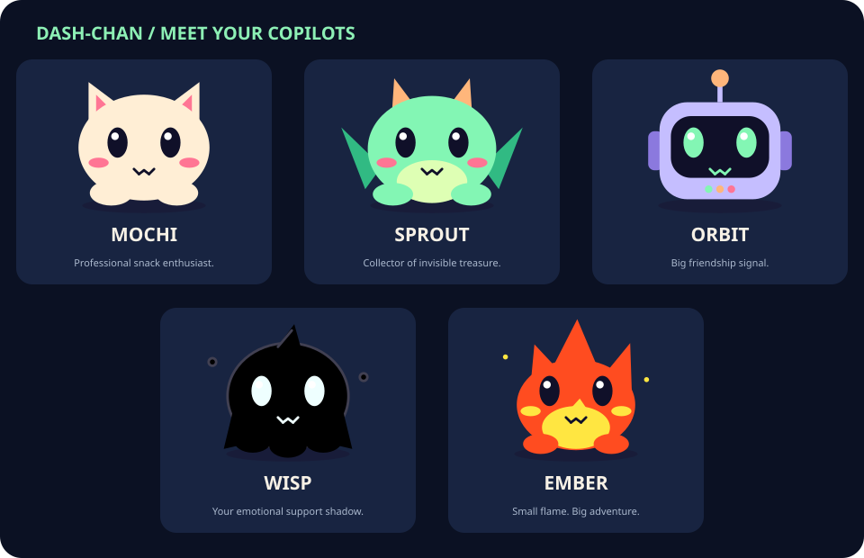
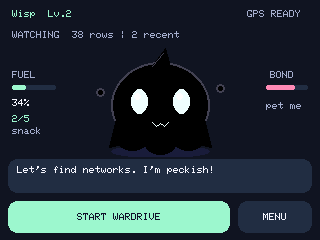
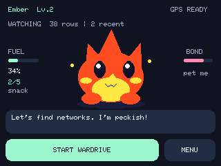
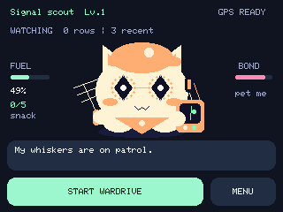
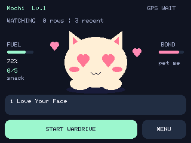
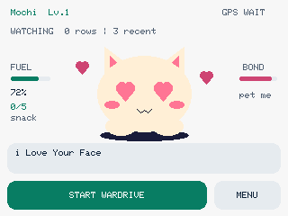
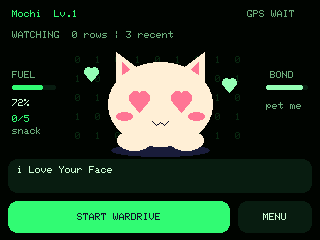
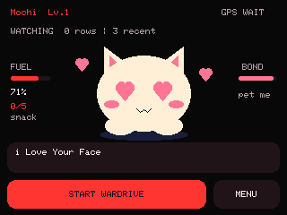
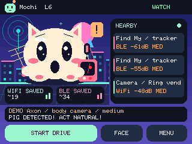

# Dash-Chan

**A tiny copilot for the invisible world.** Passive radio awareness, GPS wardriving, and an affectionate offline companion for the official **M5Stack StackChan K151**.

## [🚀 Open the web flasher & Avatar Studio](https://valleytechsolutions.github.io/Dash-Chan/)

[First adventure](docs/QUICKSTART.md) · [Flashing & recovery](docs/FLASHING.md) · [Wiki / handbook](docs/wiki/Home.md) · [Downloads](https://github.com/valleytechsolutions/Dash-Chan/releases) · [Sources & attribution](docs/SOURCES.md)



**0.4.0 beta — Wisp, Ember & GPS setup.** Adopt a cute black ghost or a tiny fire buddy, customize all five shapes in Avatar Studio, and connect a wider range of UART GPS receivers. Named M5Stack/ATGM336H presets, Grove receive-pin selection, and a one-shot baud finder are now on the robot. [GPS compatibility and wiring](docs/GPS.md).

This remains a beta: outdoor movement, detection performance, and WiGLE server acceptance need field validation. [Measured checks and limits](docs/DEVELOPMENT.md).

## Meet your copilot

| Buddy | Personality |
|---|---|
| **Mochi** | A curious cream cat with a serious snack habit. “My whiskers are on patrol.” |
| **Sprout** | A mint dragon building a tiny signal hoard. “My wings are in airplane-ish mode.” |
| **Orbit** | A lilac robot with excellent friendship reception. “My emotional support human is here.” |
| **Wisp** | An all-black little ghost with bright eyes and drifting wisps. “Your emotional support shadow.” |
| **Ember** | A tiny orange flame with flickering tips and floating sparks. “Small flame. Big adventure.” |
| **Your custom buddy** | Mix six eye styles, three colors, headwear, glasses, and neckwear on any original shape. Name it and save it in Avatar Studio. |

| Wisp on the robot | Ember on the robot |
|---|---|
|  |  |

Your pet stays visible on its home screen until **you** open a menu. Alerts use an expression, compact signal ribbon, and speech bubble. Idle gestures include glances, nods, curious looks, and quiet pauses. Petting gives heart eyes and affection; fuel and XP come from exploring.

**Wardriving is the only way to feed Dash-Chan.** Every five new Wi-Fi BSSIDs successfully written with valid GPS in the current session earn +12 fuel. Each earns one XP. BLE, background watch, petting, and demos never feed it. Per-drive approximate deduplication prevents repeat-food farming within a session; it may conservatively miss a discovery on a very large drive. Stopping and starting creates a new food session.

This is a scripted personality engine, not cloud AI. No account, microphone processing, or internet connection is needed on the robot.

## Make a buddy that looks like yours

Open **[Avatar Studio](https://valleytechsolutions.github.io/Dash-Chan/#creator)** and start with Wisp, Ember, Signal Scout, Neon Listener, Petal Patrol, or Mochi Royale. Mix **six eye styles**, **six headwear choices**, **four eyewear choices**, and **four neckwear choices**, including None. Change body, accent, and eye colors. Preview love, alert, listening, and cruising poses; save a portrait or an avatar file. Your draft stays in your browser.

**Send to StackChan** applies the design over USB without reflashing. Install 0.4 or newer for all five shapes. Earlier `DCAV1` avatar files still import. On the robot, **MENU → Look & Themes → Avatar Studio** cycles styles without a computer. [Full studio guide and profile format](docs/AVATAR-STUDIO.md).

In **Auto** field-kit mode, the pet holds a radar-style antenna and pocket receiver while recording or when fresh GPS speed confirms movement. **Always** keeps the gear visible; **Off** hides it. Cruising adds a subtle bob and travel streaks. These are personality animations: the receiver does not process audio, and the antenna does not indicate signal direction. Alerts, muting, logging, and food rules work independently of the outfit.



## Four themes, one familiar face

| Dark | Light |
|---|---|
|  |  |
| Matrix | BWM |
|  |  |

These are captures of the running firmware. The supplied **BWM and VTS logos** appear side by side at boot before the pet wakes up.

## Two jobs, always together

**Keep watch:** passive Wi-Fi/BLE listening begins at boot and continues on every screen, whether or not a wardrive is recording. The classifiers examine supported body-camera, ALPR/camera-vendor, camera-glasses, tracker, gadget, and Remote ID signatures. A detection is a **radio clue**, not authenticated identity, proof of police presence, or proof that recording is happening.

**Go exploring:** tap **START WARDRIVE** on the face. A new SD file receives valid GPS-tagged Wi-Fi access points and BLE observations in **WiGLE 1.4 CSV**. Detection alerts still work during the drive. Tap **STOP & SAVE** to close it and continue background watching.

The radio now also examines client probes, selected management/action frames, and candidate transmitter/receiver address headers for detection. Those frames are **not** written as Wi-Fi access points. It does not connect, probe, pair, deauthenticate, jam, decrypt, or save Wi-Fi data payloads.

## Personality at your volume



Spicy Axon reactions can display or speak **“PIG DETECTED! ACT NATURAL!”**, **“Oh man, the fuzz!”**, or use a siren with a panicked face and quick double-takes. Other families get captions such as “Biscuit nearby! Wait… not a snack?” and “Spicy fruit on the airwaves!” The Axon demo is synthetic and never becomes a real detection or WiGLE observation.

**Speech defaults OFF.** In **MENU → Sound & Voice**:

- **Voice OFF** disables every spoken clip while keeping configured electronic alert tones available.
- **Master sound OFF** immediately silences all audio. Preferences survive reboot and firmware updates.
- Alert tones: **Personality, Siren, Arcade, Chime, Silent**; selectable volume through 255.
- Deliberate screen petting can say **“i Love Your Face”** only when Voice is enabled, at most once per minute.
- Head-sensor petting gives visual affection without speech. Debounce and release-to-rearm prevent a held/noisy sensor from retriggering continuously.

Choose **Off / Gentle / Lively** head motion and **Spicy / Gentle** banter under Personality. Head movement starts off on a new installation, uses the BSP's factory zero positions, and stays within bounded travel. Looking around is animation, not RF direction finding.

## Alerts that know when to be quiet

The same continuing encounter is announced once by default. Its recent entry continues updating RSSI, count, and last-seen time. After **five minutes absent**, it can announce again. Stronger evidence may alert again after cooldowns. A separate **60/180/300-second family quiet period** reduces repeated notifications from rotating addresses; it does not claim those addresses belong to the same device. Optional five-minute reminders are off by default.

There are 128 encounter-ledger slots and 32 browsable recent entries. Very dense areas can evict older state. A default medium-or-higher confidence threshold keeps weak name/vendor clues quieter. [Exact methods, limits, and personal watchlists](docs/DETECTIONS.md).

## Hardware and first use

- **Official StackChan K151/CoreS3:** ESP32-S3, 16 MB flash, 8 MB Quad PSRAM, 320 × 240 landscape display. Generic DIY Stack-chan servo wiring is unsupported.
- **Native radio:** 2.4 GHz Wi-Fi and BLE. No 5 GHz, Bluetooth Classic, LoRa, or sub-GHz reception.
- **GPS:** UART NMEA on blue Port C by default (host RX G18), with A/B/custom Grove RX options. **GPS & SD → GPS SETUP** has M5Stack and ATGM336H presets plus baud search. Stack/Atom/Cap receivers need adapters; bare ATGM modules need regulated 3.3 V power. [Compatibility table and wiring](docs/GPS.md).
- **Storage:** FAT32 microSD in the robot. No automatic formatting.

Use the [web flasher](https://valleytechsolutions.github.io/Dash-Chan/#install) in desktop Chrome/Edge. It can download a full factory backup, validates the chip and flash size, checks SHA-256 downloads, writes split images without whole-chip erase, verifies written flash, and checks that NVS calibration is unchanged. The same site provides the creator, real UI images, quickstart, downloads, and attributions. [Detailed install/recovery instructions](docs/FLASHING.md).

## Controls

| Screen/control | Action |
|---|---|
| Face: START / STOP & SAVE | Open or close a wardrive |
| Face tap / top touch sensor | Affection; no food |
| Alert speech bubble | Dismiss reaction; continue listening |
| MENU → Look & Themes | Five original buddies, custom buddy, four themes, Avatar Studio and field-kit preference |
| MENU → Sound & Voice | Master mute, voice switch, tones, volume, preview/demo |
| MENU → Personality | Motion, banter, pet |
| MENU → Detection | Confidence, family quiet period, optional reminders |
| MENU → Recent Signals | Paginated evidence and last-seen details |
| MENU → GPS & SD | GPS quality, rows/drops, error text, module presets, receive pins, baud finder, wiring help, SD retry |

## Logs and GPS quality

`/wardrives/dash-00000001.csv` uses the standard 11-column WiGLE format. New Start presses create new files without overwriting earlier drives. `/events/detections.csv` records emitted alert events separately. Nothing uploads automatically.

Rows require valid UTC, a fix no older than two seconds, at least four satellites, HDOP ≤ 5, finite in-range coordinates/altitude, and packet queue latency ≤ 250 ms. GPS loss pauses rows; the firmware never fills them with invented or stale positions. `AccuracyMeters` is the documented **HDOP × 5 m estimate**, not measured error. Repeat rows are rate-limited per address/transport to 30 seconds in a bounded contact cache.

Files flush every two seconds and at Stop. Use **STOP & SAVE** before power-off or card removal. Sudden power loss can still lose buffered writes or damage FAT metadata. A write failure stops recording and reports an error while background watch continues. Keep real logs private when sharing bug reports.

## Build and contribute

```sh
python -m pip install platformio==6.2.0
pio run -e stackchan
python tools/test.py             # g++/gcc, CXX/CC, or ziglang==0.13.0
python tools/package.py          # release ZIP + site/firmware
node --test tests/web_test.mjs tests/studio_test.mjs   # Node 22+
python -m http.server 8765 --directory site
```

For browser checks: `npm install`, `npx playwright install chromium`, then `node tests/browser_test.mjs` while the local site server runs. [Architecture, serial commands, and verification](docs/DEVELOPMENT.md). GitHub Actions runs host tests, builds firmware, packages images, and tests the site. The Pages workflow publishes `site/` with generated firmware.

Report your exact board, firmware version, GPS baud, SD format, reproduction steps, and redacted status output in [Issues](https://github.com/valleytechsolutions/Dash-Chan/issues). Do not attach factory backups or unredacted wardrive files. Field testing with known emitting devices and real WiGLE uploads is welcome; neither is replaced by synthetic parser tests.

## Credits and licensing

Built with gratitude to **Dragon Detector**, **SquachWatch / skizzophrenic**, **Colonel Panic's Unified Blue / OUI Spy / Flock-You / AXEOFF**, **JustCallMeKoko's ESP32 Dual Band Wardriver / Marauder**, **Midwest Gadgets' Piglet**, **M5Stack**, **OpenDroneID**, and **Espressif**. [Pinned sources, precise reuse, and retained license notices](docs/SOURCES.md).

Dash-Chan is GPL-3.0-or-later; imported components retain their own notices. Mochi, Sprout, and Orbit are original code-drawn avatars. SquachWatch inspired expressive timing and a companion-led experience; its mascot/artwork was not copied. Piglet is a behavioral reference, not bundled source. Unified Blue's reviewed snapshot has no explicit license, so its code is not vendored. BWM/VTS brand rights remain with their owners. No upstream endorsement is implied.
