<p align="center"></p>

# Dash-Chan

**A tiny copilot for the invisible world.** Passive radio awareness, GPS wardriving, and an affectionate offline companion for the official **M5Stack StackChan K151**.

## [🚀 Open the web flasher & Avatar Studio](https://valleytech-dash-chan.pages.dev/)

**SD-card upload setup (firmware 0.8.1+):** Edit `/dashchan/config.json` with your home Wi-Fi SSID/password, WiGLE API name/token, WDGWars key and Wardrift device key. The website is optional. [Step-by-step setup guide](docs/UPLOADS.md#sd-card-setup-step-by-step) · [Blank config template](sdcard/dashchan/config.example.json) · [Current firmware and matching source](https://valleytech-dash-chan.pages.dev/firmware/Dash-Chan.zip). Existing `upload.json` files remain supported. Manual Send selected, Upload all and optional uploads after Stop + Save are explained in the guide. The guide describes the current web release; older source snapshots/releases do not include every current feature.

**Independent hosting:** the installer, Avatar Studio, firmware downloads, source archive, and guides are available without GitHub. The original [GitHub Pages address](https://valleytechsolutions.github.io/Dash-Chan/) remains configured but is currently affected by an account-level GitHub restriction.

[First adventure](docs/QUICKSTART.md) · [Flashing & recovery](docs/FLASHING.md) · [M5Burner factory-image guide](docs/M5BURNER.md) · [Wiki / handbook](docs/wiki/Home.md) · [Downloads](https://github.com/valleytechsolutions/Dash-Chan/releases) · [Sources & attribution](docs/SOURCES.md)

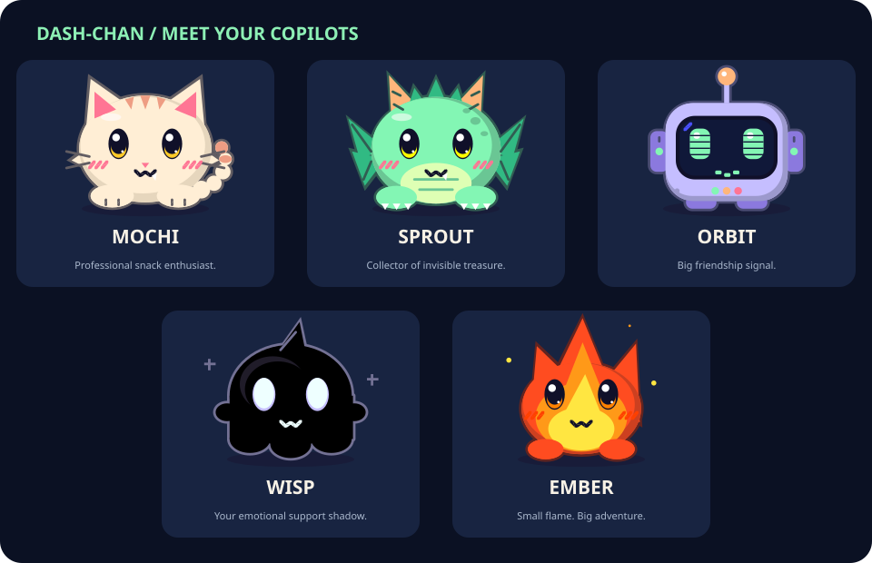

**0.5.0 beta — Arcade Scout.** A colorful virtual-pet console with **Recon + Buddy** and **Full Face** views, four illustrated backdrops, a visible level/XP bar, and every outfit unlocked. Avatar Studio keeps all five buddies and layered accessories. The simpler web workspace adds drive previews, browser WiGLE uploads, WDGWars exports, and USB/SD setup for direct device uploads. [Upload guide](docs/UPLOADS.md) · [Views and hardware play](docs/PLAY.md).

This remains a beta: outdoor movement, detection performance, and WiGLE server acceptance need field validation. [Measured checks and limits](docs/DEVELOPMENT.md).

## Two ways to hang out

| Recon + Buddy | Full Face |
|---|---|
| 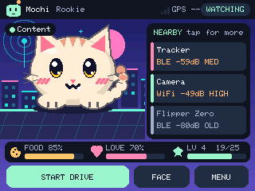 | 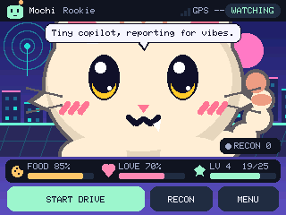 |

Tap **FACE / RECON** on the home screen. Until a drive starts, Dash-Chan is a recon tool: the **RECON** panel beside the pet shows a small radar with one dot per device in range and up to four rows, most important first. Each row has a tier colour (red surveillance, violet hacker gear, amber attack patterns, blue trackers, grey beacons), a short name, signal strength, an arrow when the signal is getting stronger or weaker, and how often it has been met. Devices that have gone out of range stay listed, dimmed, with their age. Tap a row for its device card, or the panel for the full **Recon page**. The radar is decoration plus signal strength: a dot's distance from the centre follows RSSI, its bearing is arbitrary. Once a drive is recording, the panel shrinks to the top two rows and this drive's counters, so it is a wardriving pet that still watches. Full Face keeps a small **RECON n** chip in the corner.

| Recon page | Device card | Detection settings |
|---|---|---|
| 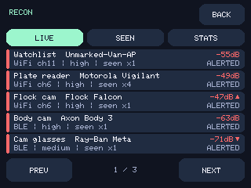 | 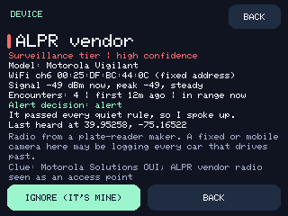 | 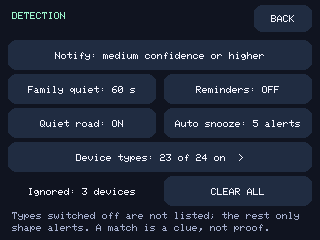 |

Both views show approximate distinct Wi-Fi/BLE addresses saved **during the current drive**, not raw packets. `~` marks conservative Bloom-filter counting; BLE address rotation can represent the same physical device more than once. Background watch still detects clues but does not collect a drive or feed the pet.

Every 25 eligible Wi-Fi discoveries advances one level. XP continues across restarts. Saved discoveries get a quick happy bounce and pixel sparks; each level earns a confetti celebration. Alerts take visual priority. **All buddies, eyes, colors and outfits are available immediately.** Petting builds affection, and only wardriving earns food.

**Display + Fun** chooses Signal City, Sunset Run, Star Patrol or Pixel Garden. Separate switches control mood lights, tilt/gaze, head-swipe view switching, wave hello and automatic brightness. Optional NFC outfit cards recall a saved look from one of your own ISO14443A tags. The camera and microphone are unused. [Hardware play guide](docs/PLAY.md).

## Upload when you get home

Open **[Upload drives](https://valleytech-dash-chan.pages.dev/#uploads)** to preview a CSV, send it directly to WiGLE, or export a WiGLE 1.6 copy for WDGWars. Browser credentials remain in memory for that visit. WDGWars currently disallows the browser's cross-origin request, so its browser path is an export, not a pretend upload.

For the robot, enter your 2.4 GHz network and selected service API credentials, then **Send setup over USB** or download `/dashchan/upload.json`. On StackChan, **Menu → Upload drives** lets you choose a saved drive and confirm sending. Optional **auto-send after Stop + Save** starts off. HTTPS verifies certificates; accepted/uncertain receipts prevent blind automatic resubmission. Original CSVs remain on SD. The setup file contains readable credentials and must stay private. [Setup, limits and recovery](docs/UPLOADS.md).

## Meet your copilot

| Buddy | Personality |
|---|---|
| **Mochi** | A curious cream cat with a serious snack habit. “My whiskers are on patrol.” |
| **Sprout** | A mint dragon building a tiny signal hoard. “My wings are in airplane-ish mode.” |
| **Orbit** | A lilac robot with excellent friendship reception. “My emotional support human is here.” |
| **Wisp** | An all-black little ghost with bright eyes and drifting wisps. “Your emotional support shadow.” |
| **Ember** | A tiny orange flame with flickering tips and floating sparks. “Small flame. Big adventure.” |
| **Your custom buddy** | Start from a style pack (kawaii, cyberpunk, goth, vaporwave, retro terminal) or mix ten eye styles, three colors, headwear, glasses, neckwear, face marks, wings, held items, and auras on any shape. Pick whose lines it speaks, name it, and save it in Avatar Studio. |

| Wisp on the robot | Ember on the robot |
|---|---|
| 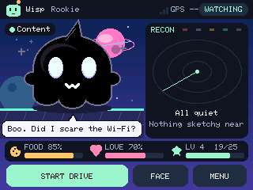 | 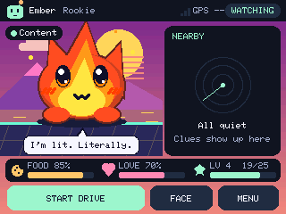 |

Curious brows, bright eye highlights, paw pads, heart reactions, and open-mouth cheers give the five buddies a little more character. Your pet stays visible on its home screen until **you** open a menu. Alerts use an expression, compact signal ribbon, and speech bubble. Idle gestures include glances, nods, curious looks, and quiet pauses. Petting gives heart eyes and affection; fuel and XP come from exploring.

**Wardriving is the only way to feed Dash-Chan.** Every five new Wi-Fi BSSIDs successfully written with valid GPS in the current session earn +12 fuel. Each earns one XP. BLE, background watch, petting, and demos never feed it. Per-drive approximate deduplication prevents repeat-food farming within a session; it may conservatively miss a discovery on a very large drive. Stopping and starting creates a new food session.

### A pet with moods, not a soundboard

Dash-Chan keeps track of how it feels and talks about that instead of looping one phrase:

- **Feelings:** Content, Hyped, Hungry, Lonely, Bored, Drowsy or Napping, shown as a tag above the buddy. Low fuel or low love brings a pouty face; ignore it for 12 minutes off the road (the clock starts when the car stops, recorded drive or not) and it dozes off with drifting Zs until you tap or pet it.
- **No repeats:** about 330 lines across 50 situations, with extra lines unique to each buddy and a sassier set when Banter is Spicy. Every line in a situation is used once before any comes back, and remarks arrive at irregular gaps.
- **Petting has a combo:** a couple of pets earn love, quick repeats get giggles, and six in a row gets “Okay okay okay! I'm fully petted!” with no extra love.
- **It notices the drive:** drive starts, red lights, dry stretches, sudden bursts of networks, missing GPS, per-drive milestones, and now and then the real name of a network it just logged (“Ooh, 'CoffeeShop'. Tasty.”).
- **It remembers:** love, lifetime pets, snacks, drives and your best drive survive restarts. Beat your record and it says so. **MENU → Personality** shows the tally.

- **It reacts differently to each clue:** body cameras, plate readers, trackers, smart glasses, Flippers, drones, watchlist hits and oddities each have their own rotating lines.
- **It misses you:** time keeps passing while the robot is off. Once GPS (or the board clock, after GPS has set it) knows the time, food and love drop for the hours apart, down to a floor, and after eight hours it tells you how long you were gone.
- **It grows up:** levels carry ranks, from Hatchling and Rookie through Scout, Ranger, Pathfinder and Signal Sage to Legend.

### The home screen at a glance

- **Top bar:** buddy name and rank, GPS bars with satellite count, and a state pill (WATCHING, REC, NO GPS, NO SD, UPLOAD).
- **Stage:** the buddy with a feeling tag. Everything it says appears in a speech bubble pointing at it; drive counters for saved Wi-Fi and BLE sit underneath once a drive has started.
- **Vitals row:** FOOD, LOVE and XP meters that are always visible. A meter turns red and blinks when it is low. Tap the row for the buddy's report card (pets, snacks, drives, best drive).
- **Full Face** redraws the buddy large from the same shapes, so it stays sharp instead of being a stretched thumbnail.

The buddies themselves were redrawn with outlines, shading and their own details: Mochi's tabby stripes, tail and whiskers; Sprout's wings, horns and claws; Orbit's LED-panel eyes; Wisp's glow rim and hollow eyes; Ember's layered flame.

Love fades slowly when it is awake and alone, never while you are driving together; every snack adds a little. To add or edit lines, open [`include/personality.h`](include/personality.h) — one row per line.

This is a scripted personality engine, not cloud AI. No account, microphone processing, or internet connection is needed on the robot.

## Make a buddy that looks like yours

Open **[Avatar Studio](https://valleytech-dash-chan.pages.dev/#creator)** and start with a **style pack**: Kawaii pastel, Cyberpunk neon, Goth, Vaporwave, or Retro terminal. One tap dresses your current shape and never renames it. Then mix **ten eye styles**, **twelve headwear**, **eight eyewear**, and **eight neckwear** choices (including None), plus face marks, wings and capes, held items, auras, and a persona that decides whose lines your buddy speaks: over 90 million looks before colors. Every option is drawn on your own buddy. Surprise me, Shuffle pack, undo/redo, and a shelf of saved designs make it easy to experiment. Preview love, alert, discovery cheers, listening, and cruising poses in four arcade worlds; save a portrait or an avatar file. Your draft stays in your browser.

**Send to StackChan** applies the design over USB without reflashing. Install 0.4 or newer for all five shapes; designs that use the newer gear are saved as `DCAV3` and need current firmware, while plain designs are still saved as `DCAV2` for older robots. Earlier `DCAV1` and `DCAV2` avatar files still import. On the robot, **MENU → Buddy + Look → Avatar Studio** shows a live preview and cycles shape, face, outfit, extras, and style packs without a computer. [Full studio guide and profile format](docs/AVATAR-STUDIO.md).

In **Auto** field-kit mode, the pet holds a radar-style antenna and pocket receiver while recording or when fresh GPS speed confirms movement. **Always** keeps the gear visible; **Off** hides it. Cruising adds a subtle bob and travel streaks. These are personality animations: the receiver does not process audio, and the antenna does not indicate signal direction. Alerts, muting, logging, and food rules work independently of the outfit.

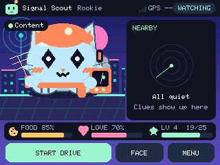

## Four themes, one familiar face

| Dark | Light |
|---|---|
| 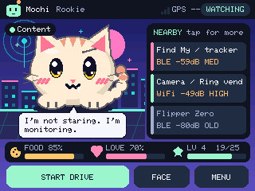 | 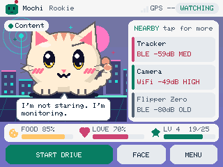 |
| Matrix | BWM |
| 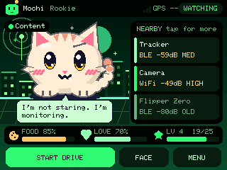 | 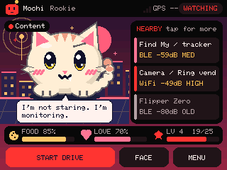 |

These screens are rendered on a PC by `tools/preview.py` from the same drawing code the firmware runs; the LCD differs slightly in color and edge smoothing. The supplied **BWM and VTS logos** appear side by side at boot before the pet wakes up.

## Two jobs, always together

**Keep watch:** passive Wi-Fi/BLE listening begins at boot and continues on every screen, whether or not a wardrive is recording. A configured upload temporarily pauses both radios, then restores watching. The classifiers examine supported body-camera, ALPR/camera-vendor, camera-glasses, tracker, gadget, and Remote ID signatures. A detection is a **radio clue**, not authenticated identity, proof of police presence, or proof that recording is happening.

**Go exploring:** tap **START DRIVE** on the face. A new SD file receives valid GPS-tagged Wi-Fi access points and BLE observations in **WiGLE 1.4 CSV**. Detection alerts still work during the drive. Tap **STOP + SAVE** to close it and continue background watching.

The radio now also examines client probes, selected management/action frames, and candidate transmitter/receiver address headers for detection. Those frames are **not** written as Wi-Fi access points. Watching does not connect, probe, pair, deauthenticate, jam, decrypt, or save Wi-Fi data payloads. Only the optional upload activity joins your configured Wi-Fi.

## Personality at your volume

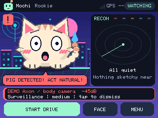

Spicy Axon reactions can display or speak **“PIG DETECTED! ACT NATURAL!”**, **“Oh man, the fuzz!”**, or use a siren with a panicked face and quick double-takes. Other families get captions such as “Biscuit nearby! Wait… not a snack?” and “Spicy fruit on the airwaves!”, or, with Voice on, a short spoken announcement in a small high voice: “Flock camera spotted!”, “Tracker spotted!”, “Drone overhead!” The Axon demo is synthetic and never becomes a real detection or WiGLE observation.

**Speech defaults OFF.** In **MENU → Sound & Voice**:

- **Voice: OFF / ALERTS / ALL.** OFF keeps the electronic alert tones and never speaks. ALERTS speaks one short announcement per detection family. ALL also speaks pet and system phrases: “Let's go for a drive!”, “Drive saved!”, “GPS locked!”, “GPS lost!”, “Level up! Nice!”, “I'm hungry!”, “That really tickles!”, “All clear!”, “No SD card!” and greetings.
- Speech works with every alert tone except **Silent**: a two-note chirp, then the phrase, instead of the long tone. The screen shows the words being spoken.
- Speech is rate-limited: at least 4 seconds between clips, one pet phrase per 20 seconds, the same pet phrase at most every 5 minutes. A detection interrupts a pet phrase, never the other way round.
- **TEST VOICE** speaks the next clip each time you press it, so you can hear the whole set.
- The voice is synthesized offline at build time and stored in the firmware; nothing is sent anywhere. The clips have been checked by speech recognition only. **Nobody has listened to them by ear yet**, so expect some to need rewording.
- **Master sound OFF** immediately silences all audio. Preferences survive reboot and firmware updates.
- Alert tones: **Personality, Siren, Arcade, Chime, Silent**; selectable volume through 255.
- Deliberate screen pets get a short chirp and a line that changes every time. The recorded **“i Love Your Face”** clip is a rare treat at 85%+ Love with Voice ALL.
- Head-sensor petting gives visual affection without speech. Debounce and release-to-rearm prevent a held/noisy sensor from retriggering continuously.

Choose **Off / Gentle / Lively** head motion and **Spicy / Gentle** banter under Personality. Head movement starts off on a new installation, uses the BSP's factory zero positions, and stays within bounded travel. Looking around is animation, not RF direction finding.

## Alerts that know when to be quiet

Everything Dash-Chan can classify is **listed**, except device types you have switched off (shop beacons start off); only some of it **alerts**. An alert is a tier-coloured card with the name, signal strength and a **DETAILS** button; tapping anywhere else dismisses it. The card appears over whatever page is open. Two alerts are about behaviour rather than brand: a **tracker flood** (dozens of new tag addresses in a minute, probably a spam gadget) and a tag that has **stayed with you** across several places. With head motion on, the flinch is bigger for a closer, more serious device and is held to a small nod while driving.

The same continuing encounter is announced once by default. Its row keeps updating RSSI, count, and last-seen time. After **five minutes absent**, it can announce again. Stronger evidence may alert again after cooldowns. A separate **60/180/300-second family quiet period** reduces repeated notifications from rotating addresses; it does not claim those addresses belong to the same device. Optional five-minute reminders are off by default.

The list holds 256 devices and the last 64 come back from the SD card after a restart. Very dense areas can evict older rows. **MENU → Detection** also has **Quiet road** (tags and Ring cameras are listed but silent while driving), **Auto snooze** (after 5 or 10 alerts a device must come closer to speak again), a **device type** filter (applied when you leave its page; a type that is off is not listed), and the count of devices you have marked as your own with **CLEAR ALL**. A default medium-or-higher confidence threshold keeps weak name/vendor clues quieter. [Exact methods, limits, and personal watchlists](docs/DETECTIONS.md).

## Hardware and first use

- **Official StackChan K151/CoreS3:** ESP32-S3, 16 MB flash, 8 MB Quad PSRAM, 320 × 240 landscape display. Generic DIY Stack-chan servo wiring is unsupported.
- **Native radio:** 2.4 GHz Wi-Fi and BLE. No 5 GHz, Bluetooth Classic, LoRa, or sub-GHz reception.
- **GPS:** UART NMEA on blue Port C by default (host RX G18), with A/B/custom Grove RX options. **GPS & SD → GPS SETUP** has M5Stack and ATGM336H presets plus baud search. Stack/Atom/Cap receivers need adapters; bare ATGM modules need regulated 3.3 V power. [Compatibility table and wiring](docs/GPS.md).
- **Storage:** FAT32 microSD in the robot. No automatic formatting.

Use the [web flasher](https://valleytech-dash-chan.pages.dev/#install) in desktop Chrome/Edge. It can download a full factory backup, validates the chip and flash size, checks SHA-256 downloads, writes split images without whole-chip erase, verifies written flash, and checks that NVS calibration is unchanged. The same site provides the creator, real UI images, quickstart, downloads, and attributions. [Detailed install/recovery instructions](docs/FLASHING.md).

## Controls

| Screen/control | Action |
|---|---|
| Face: START / STOP & SAVE | Open or close a wardrive |
| Face tap / top touch sensor | Affection; no food |
| Alert card or bubble | Dismiss reaction; continue listening. **DETAILS** opens the device card |
| RECON panel / RECON chip | Open the Recon page; a row opens that device's card |
| MENU → Buddy + Look | Five original buddies, custom buddy, four themes, Avatar Studio (face, outfit, extras, style packs) and field-kit preference |
| MENU → Sound & Voice | Master mute, voice mode (OFF / ALERTS / ALL), tones, volume, tone preview, TEST VOICE, demo |
| MENU → Personality | Motion, banter, pet |
| MENU → Detection | Confidence, family quiet period, optional reminders, quiet road, auto snooze, device types, ignored devices |
| MENU → Recon List | LIVE (in range now), SEEN (everything, including rows restored from the SD ledger), STATS (lifetime counts); tap a row for its card and **IGNORE** |
| MENU → GPS & SD | GPS quality, rows/drops, error text, module presets, receive pins, baud finder, wiring help, SD retry |

## Logs and GPS quality

`/wardrives/dash-00000001.csv` uses the standard 11-column WiGLE format. New Start presses create new files without overwriting earlier drives. `/events/recon.csv` is the detection ledger: one line when a classified device is first heard, when it returns after two minutes away, and when it alerts ([format](docs/DEVELOPMENT.md#recon-table-alert-policy-and-ledger)). Uploads are disabled until configured; automatic sending requires an explicit opt-in.

Rows require valid UTC, a fix no older than two seconds, at least four satellites, HDOP ≤ 5, finite in-range coordinates/altitude, and packet queue latency ≤ 250 ms. GPS loss pauses rows; the firmware never fills them with invented or stale positions. `AccuracyMeters` is the documented **HDOP × 5 m estimate**, not measured error. Repeat rows are rate-limited per address/transport to 30 seconds in a bounded contact cache.

Files flush every two seconds and at Stop. Use **STOP + SAVE** before power-off or card removal. Sudden power loss can still lose buffered writes or damage FAT metadata. A write failure stops recording and reports an error while background watch continues. Keep real logs private when sharing bug reports.

## Build and contribute

```sh
python -m pip install platformio==6.2.0
pio run -e stackchan
python tools/test.py             # g++/gcc, CXX/CC, or ziglang==0.13.0
python tools/package.py          # release ZIP + site/firmware
node --test tests/web_test.mjs tests/studio_test.mjs   # Node 22+
python -m http.server 8765 --directory site
```

For browser checks: `npm install`, `npx playwright install chromium`, then `node tests/browser_test.mjs` while the local site server runs. [Architecture, serial commands, and verification](docs/DEVELOPMENT.md). GitHub Actions runs host tests, builds firmware, packages images, and tests the site. The Pages workflow publishes `site/` with generated firmware.

Report your exact board, firmware version, GPS baud, SD format, reproduction steps, and redacted status output in [Issues](https://github.com/valleytechsolutions/Dash-Chan/issues). Do not attach factory backups or unredacted wardrive files. Field testing with known emitting devices and real WiGLE uploads is welcome; neither is replaced by synthetic parser tests.

## Credits and licensing

Built with gratitude to **Dragon Detector**, **SquachWatch / skizzophrenic**, **Colonel Panic's Unified Blue / OUI Spy / Flock-You / AXEOFF**, **JustCallMeKoko's ESP32 Dual Band Wardriver / Marauder**, **Midwest Gadgets' Piglet**, **M5Stack**, **OpenDroneID**, and **Espressif**. [Pinned sources, precise reuse, and retained license notices](docs/SOURCES.md).

Dash-Chan is GPL-3.0-or-later; imported components retain their own notices. Mochi, Sprout, and Orbit are original code-drawn avatars. SquachWatch inspired expressive timing and a companion-led experience; its mascot/artwork was not copied. Piglet is a behavioral reference, not bundled source. Unified Blue's reviewed snapshot has no explicit license, so its code is not vendored. BWM/VTS brand rights remain with their owners. No upstream endorsement is implied.
