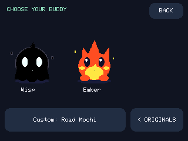
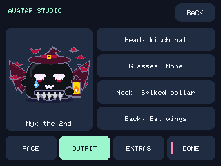

# Avatar Studio

Build a companion with its own face, colours, outfit and attitude in **[the web studio](https://valleytech-dash-chan.pages.dev/#creator)**. No account is needed and everything is unlocked. Plain designs work on **Dash-Chan 0.3 or newer** (0.4 for Wisp and Ember). Designs that use the newer gear need firmware that reads the `DCAV3` profile: it reports `avatar_schema` 3 in `STATUS`. Older firmware refuses such a profile outright and keeps the buddy it has.

## Create and send

1. **Start with a style pack**, or skip it. Kawaii pastel, Cyberpunk neon, Goth, Vaporwave and Retro terminal each dress your *current* shape in one tap: colours, eyes, gear, face mark, back item, aura and a suggested preview world. A pack never changes your buddy's name, shape or persona.
2. Work through the tabs. Every option is drawn on your own buddy, so you see exactly what you are picking.
   - **Shape:** cat, dragon, robot, ghost or flame.
   - **Face:** eye style and a face mark.
   - **Colours:** palettes from each pack and the five classic buddies, plus body, accent and eye colour pickers. If the eyes would vanish into the body (or into Orbit's dark screen) the studio warns you and offers a readable colour.
   - **Outfit:** headwear, glasses, neckwear, something on the back and something in its paws. Mix them freely.
   - **Vibe:** an aura of drifting particles, and a persona: whose lines the buddy speaks, with a sample.
3. Name your buddy with 1-16 ASCII letters, digits, spaces, hyphens or underscores.
4. Preview happy, love, alert and discovery-cheer moods. Tap the buddy for heart eyes; Love and Cheer fade back after a few seconds. Glasses lift during love, panic and cheers so the expression stays visible.
5. Stop any recording and disconnect the installer. Click **Send to StackChan**, choose the robot's USB port, and wait for the acknowledgement. The custom buddy becomes active immediately. Audio preferences remain unchanged.

**Surprise me** rolls a whole new buddy: shape, colours, face, gear, aura and persona. It keeps the name and never produces unreadable eyes. **Shuffle pack** stays inside the current pack's palettes and wardrobe and keeps your shape. **Undo** and **Redo** (or Ctrl+Z / Ctrl+Shift+Z) step through your last 20 changes. On a phone the preview stays pinned to the top while you edit.

The web preview does not scan radios or move the robot. The world selector previews Signal City, Sunset Run, Star Patrol and Pixel Garden; set the robot's world separately in Display + Fun. The adventure selector previews chilling, listening or cruising; the robot chooses its field gear using recording state, GPS and its Field kit setting. World and mood previews are not part of avatar.cfg. The transparent portrait export contains the buddy and props, without the habitat. If your device asks for reduced motion, the preview and its aura hold still.

## Your design stays yours

The studio saves a valid draft in this browser's local storage. **My buddies** keeps up to 12 saved designs on a shelf in the same storage; loading one restores its name too. The starter buddies beside it (Wisp, Ember, Signal Scout, Neon Listener, Petal Patrol, Mochi Royale) are looks only and keep the name you chose. Clearing site data removes drafts and the shelf; private browsing may not retain them. **Download avatar.cfg** creates a portable design file. **Import avatar.cfg** accepts current and older profiles. Invalid imports leave the current design intact. **Save portrait** creates a transparent PNG for sharing, not a firmware sprite upload.

USB profiles are saved in device NVS. Alternatively, place `avatar.cfg` at `/dashchan/avatar.cfg` on the microSD. That file takes priority at each boot or SD retry; remove or update it if you later want a USB design to persist. Never remove the SD during recording.



## Styles

Numbers start at zero and are the numbers used in a profile line. Options in *italics* need `DCAV3`.

| Slot | Choices, in profile-number order |
|---|---|
| Shape (`base`) | Mochi cat, Sprout dragon, Orbit robot, Wisp ghost, Ember flame |
| Eyes | Classic, Sparkle, Sleepy, Cat eyes, Pixel, Wink, *Heart, Star, Glitch X, Half-lid* |
| Headwear | None, Bow, Crown, Beanie, Flower, Scout cap, *Cat-ear headphones, Witch hat, Halo, Horns, Antenna headband, Hood* |
| Eyewear | None, Round glasses, Shades, Cyber visor, *Heart shades, Monocle, Eyepatch, Scan-line HUD* |
| Neckwear | None, Scarf, Bandana, Bow tie, *Choker, Spiked collar, Bell collar, Neck headphones* |
| *Mark* | None, Blush hearts, Star cheek, Whisker stripes, Tear, Circuit trace, Stitch scar, Barcode |
| *Back* | None, Angel wings, Bat wings, Cape, Backpack antenna, Jet thrusters, Fairy wings |
| *Held* | None, Boba tea, Lollipop, Game pad, Lantern, Plush bear |
| *Aura* | None, Sparkles, Hearts, Glitch pixels, Embers, Bats, Petals |
| *Pack* | None, Kawaii pastel, Cyberpunk neon, Goth, Vaporwave, Retro terminal |
| *Persona* | Match shape, Mochi, Sprout, Orbit, Wisp, Ember |

That is **90,316,800 looks** (5 x 10 x 12 x 8 x 8 x 8 x 7 x 6 x 7) before colours, names, packs and personas. Love, blinking, sleep, panic and short discovery cheers temporarily override the chosen resting eyes. LCD RGB565 colours and browser antialiasing differ slightly.

Notes on the newer slots:

- **Accent colour** tints the gear, blush, wings and aura. Outlines and shading are derived from the body colour, so a custom buddy always gets a matching sticker outline, gear included.
- **Held** items sit in the buddy's right paw. While the field kit is showing (see below) the antenna and receiver take their place.
- **Aura** is at most eight small particles, animated from a counter with no stored state. It is decoration only.
- **Persona** changes which buddy's lines are spoken: a ghost can talk like Mochi. It does not change sound, voice, volume or motion. *Match shape* keeps the shape's own lines.
- **Pack** is a tag that remembers which style pack a look came from. It does not draw anything by itself; editing any slot afterwards is fine.
- Eye colours that would be invisible are corrected when drawn: a dark colour on a dark body or on Orbit's screen is lightened, and a pale colour on a pale body becomes ink. The studio's contrast warning tells you before you send.

### Style packs

A pack sets every slot below on the shape you already have. The same signature looks are built into the firmware, so the robot's own **Style** button and the website agree.

| Pack | Body / accent / eyes | Eyes | Head | Glasses | Neck | Mark | Back | Held | Aura | Suggested world |
|---|---|---|---|---|---|---|---|---|---|---|
| Kawaii pastel | `FFD9EC` / `FF6FAE` / `6B3FA0` | Sparkle | Bow | None | Bell collar | Blush hearts | Fairy wings | None | Hearts | Pixel Garden |
| Cyberpunk neon | `1A1433` / `FF2BD6` / `2BF5FF` | Pixel | Cat-ear headphones | Scan-line HUD | None | Circuit trace | Jet thrusters | None | Glitch pixels | Signal City |
| Goth | `17141F` / `B3123C` / `F2E9FF` | Half-lid | Witch hat | None | Spiked collar | Tear | Bat wings | Lantern | Bats | Star Patrol |
| Vaporwave | `B967FF` / `01CDFE` / `FFFB96` | Star | Flower | None | None | Star cheek | Angel wings | Boba tea | Sparkles | Sunset Run |
| Retro terminal | `0D1F12` / `33FF66` / `8DFFA8` | Pixel | Antenna headband | None | None | Barcode | Backpack antenna | Game pad | Glitch pixels | Signal City |

On the website each pack also has three more palettes and a small wardrobe that **Shuffle pack** draws from.

Wisp is an all-black ghost with bright eyes, a charcoal edge and drifting wisps. Ember has flickering flame tips and rising sparks. Both support every outfit layer, affection, panic and field gear. Choose their starters for the default colours, or customise them freely. On the robot, **Buddy + Look → Choose buddy → WISP/EMBER** opens their adoption page. The five preset buddies always wear their own look; gear belongs to the custom buddy.

## Change styles on the robot

Open **MENU → Buddy + Look → Avatar Studio**. A live preview of your custom buddy sits on the left; four buttons on the right each step through one slot. Three pages share those buttons:

- **FACE:** Shape, Eyes, Mark, Style (the style pack).
- **OUTFIT:** Head, Glasses, Neck, Back.
- **EXTRAS:** Holding, Aura, Talks like (persona), Field kit.

**Style** cycles Kawaii pastel, Cyberpunk neon, Goth, Vaporwave, Retro terminal and then **My own look**, which puts back the colours, gear and background you had when you opened the page. Choosing a pack on the robot also switches to its suggested background. Any change activates the custom buddy; **DONE** returns home. Names and individual colours are edited in the web studio.



**Field kit** is a cosmetic preference shared by all avatars:

- **Auto:** antenna, receiver and listening earpiece appear while recording or when GPS confirms movement.
- **Always:** show the kit even when chilling.
- **Off:** hide the kit. Watching, alerts and logging continue normally.

Cruising requires a usable fix and fresh GPS speed of at least **5 km/h for three seconds**. It ends after **five seconds at or below 2 km/h**, or immediately when fix/speed becomes invalid or stale. The gap reduces flicker near a threshold. GPS noise can still cause false movement, and slow travel may not trigger cruising. This is not a car detector or a verified road-speed instrument.

The antenna bobs and the receiver screen sweeps during travel. They are original animated props, not RF direction finding or audio surveillance. Alerts still use the pet's face and signal ribbon; wardrobe changes do not affect classifiers, WiGLE rows, food or mute settings.

## NFC outfit cards

A linked card stores the whole look, including the newer slots. Cards linked by earlier firmware keep working: their shorter record is read as it always was and the new slots start empty. Re-link a card to store a look that uses them. [How to link a card](PLAY.md#nfc-outfit-cards).

## Profile format

One line of text. Fields are separated by exactly one space, colours are six hexadecimal digits without `#`, numbers are plain decimals without padding, and the name is everything after the last number (so it may contain spaces).

```text
DCAV3 3 17141F B3123C F2E9FF 9 7 0 5 4 2 4 5 3 1 Nyx the 2nd
```

`DCAV3 base body accent eye eyes headwear eyewear neckwear mark back held aura pack persona name`

| Field | Range |
|---|---|
| base | 0-4 |
| body, accent, eye | `000000`-`FFFFFF` |
| eyes | 0-9 |
| headwear | 0-11 |
| eyewear, neckwear, mark | 0-7 |
| back, aura | 0-6 |
| held, pack, persona | 0-5 |
| name | 1-16 of `A-Z a-z 0-9 space - _`, not starting or ending with a space |

The longest possible line is 66 characters. Firmware and website both refuse a line with any field out of range, a colour that is not exactly six hex digits, doubled spaces, padded numbers or a bad name, and leave the current buddy untouched.

**Older formats still load**, with every newer slot set to its first option:

```text
DCAV2 0 FFF3D2 FFAD73 1 101029 5 0 2 Signal scout
DCAV1 0 FFF3D2 FF88B6 1 Road Mochi
```

`DCAV2 base body accent eyes eye headwear eyewear neckwear name` carries eyes 0-5, headwear 0-5, eyewear 0-3 and neckwear 0-3 (note the eye colour comes *after* the eye style here). `DCAV1 base body accent accessory name` migrates automatically: bow and crown become headwear, scarf becomes neckwear, and the eye colour is chosen by shape. DCAV1 is limited to the three original shapes. Updating firmware also migrates saved legacy accessory preferences.

**Which format the studio writes.** A design that fits `DCAV2` is still written as `DCAV2`, so plain designs keep loading on firmware 0.3 to 0.5. As soon as a design uses a newer option or slot it is written as `DCAV3`. The name is last in both formats and may contain digits and spaces, which is why the new fields could not simply be appended to `DCAV2`: older firmware would have read them as part of the name.

**USB.** The uploader sends `STATUS` and reads `avatar_schema`, the newest profile format the firmware understands. It needs 2 or more for a `DCAV2` line and 3 or more for a `DCAV3` line; otherwise it stops with an explanation before sending anything. It then sends `AVATAR SET <line>` and expects `AVATAR OK`. Uploads are refused during recording. Wisp and Ember additionally require `avatar_bases:5` (firmware 0.4). `AVATAR GET` reports the saved fields as JSON with RGB565 colour values.

Saved settings, NFC cards, the on-device studio, the parser and the website all take their slot counts from one header, `include/avatar_limits.h`; the website's tests fail if its lists drift from it.
