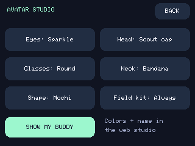

# Avatar Studio

Build a companion with its own eyes and outfit in **[the web studio](https://valleytechsolutions.github.io/Dash-Chan/#creator)**. The robot needs **Dash-Chan 0.3 or newer** for the new style fields. No account is needed.

## Create and send

1. Start with Signal Scout, Neon Listener, Petal Patrol, or Mochi Royale, or make your own combination.
2. Choose a cat, dragon, or robot shape. Pick an eye style and body, accent, and eye colors.
3. Combine headwear, eyewear, and neckwear independently. Name your buddy using 1–16 ASCII letters, digits, spaces, hyphens, or underscores.
4. Preview happy, love, and alert moods; switch between chilling, listening, and cruising. Tap the preview for hearts. Glasses lift during love and panic so the expression stays visible.
5. Stop any recording and disconnect the installer. Click **Send to StackChan**, choose the robot's USB port, and wait for the acknowledgement. The custom buddy becomes active immediately. Audio preferences remain unchanged.

The web preview does not scan radios or move the robot. Its scene selector is for previewing artwork; the device chooses its scene using recording state, GPS, and its Field kit setting.

## Your design stays yours

The studio saves a valid draft in this browser's local storage. Clearing site data removes it; private browsing may not retain it. **Download avatar.cfg** creates a portable design file. **Import avatar.cfg** accepts current and original profiles. Invalid imports leave the current design intact. **Save portrait** creates a transparent PNG for sharing, not a firmware sprite upload.

USB profiles are saved in device NVS. Alternatively, place `avatar.cfg` at `/dashchan/avatar.cfg` on the microSD. That file takes priority at each boot or SD retry; remove or update it if you later want a USB design to persist. Never remove the SD during recording.

## Styles

| Layer | Choices, in profile-number order starting at zero |
|---|---|
| Shape | Cat, Dragon, Robot |
| Eyes | Classic, Sparkle, Sleepy, Cat eyes, Pixel, Wink |
| Headwear | None, Bow, Crown, Beanie, Flower, Scout cap |
| Eyewear | None, Round glasses, Shades, Cyber visor |
| Neckwear | None, Scarf, Bandana, Bow tie |

That is **1,728 combinations** before colors and names. Love, blinking, sleep, and panic temporarily override the chosen resting eyes. LCD RGB565 colors and browser antialiasing differ slightly.

## Change styles on the robot

Open **MENU → Look & Themes → Avatar Studio**. Tap Eyes, Head, Glasses, Neck, or Shape to cycle a choice and activate the custom buddy. Tap **Show my buddy** to return home. Names and colors are edited in the web studio.



**Field kit** is a cosmetic preference shared by all avatars:

- **Auto:** antenna, receiver, and listening earpiece appear while recording or when GPS confirms movement.
- **Always:** show the kit even when chilling.
- **Off:** hide the kit. Watching, alerts, and logging continue normally.

Cruising requires a usable fix and fresh GPS speed of at least **5 km/h for three seconds**. It ends after **five seconds at or below 2 km/h**, or immediately when fix/speed becomes invalid or stale. The gap reduces flicker near a threshold. GPS noise can still cause false movement, and slow travel may not trigger cruising. This is not a car detector or a verified road-speed instrument.

The antenna bobs and the receiver screen sweeps during travel. They are original animated props, not RF direction finding or audio surveillance. Alerts still use the pet's face and signal ribbon; wardrobe changes do not affect classifiers, WiGLE rows, food, or mute settings.

## Profile format

```text
DCAV2 0 FFF3D2 FFAD73 1 101029 5 0 2 Signal scout
```

Fields: `DCAV2 base bodyRGB accentRGB eyes eyeRGB headwear eyewear neckwear name`. RGB values are six hexadecimal digits without `#`. Style numbers follow the table above. Firmware and web tools validate bounds and reject malformed profiles.

Original `DCAV1 base bodyRGB accentRGB accessory name` files migrate automatically: bow becomes headwear, scarf becomes neckwear, and crown becomes headwear. Original eye color is retained by shape. Updating firmware also migrates saved legacy accessory preferences.

USB uses `STATUS` with `avatar_schema:2`, then `AVATAR SET DCAV2 …`, and expects `AVATAR OK`. Uploads refuse during recording. An older firmware is refused before sending a new profile. `AVATAR GET` reports saved fields using RGB565 color values.
