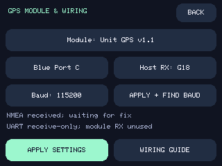

# GPS modules and DIY wiring

Dash-Chan 0.4 adds **MENU → GPS & SD → GPS SETUP**. Choose a module preset, the actual Grove port or receive pin, and a baud rate. **APPLY SETTINGS** saves them; **APPLY + FIND BAUD** applies your wiring selection and listens for the module's current speed. Existing installations keep their port and baud on update.

The presets cover the M5Stack standalone UART GPS/GNSS families below, plus ATGM336H DIY boards. Compatibility means receiving their **NMEA UART output**. Stackable modules, Atom bases, and Cap modules need suitable breakouts/adapters; selecting a preset does not make their connectors fit StackChan. Only the attached Unit GPS v1.1 on Port C has been physically tested for this release. Other entries are based on the linked manufacturer documentation and parser tests.



## Pick your receiver

All presets use 8 data bits, no parity, 1 stop bit. These are starting speeds: a receiver previously configured elsewhere may use a different one.

| Settings preset | Starting baud | Connection to K151 / primary reference |
|---|---:|---|
| Unit GPS (AT6558), U032 | 9600 | Grove cable to Port C. [M5Stack](https://docs.m5stack.com/en/unit/gps) |
| Unit GPS v1.1, U032-V11 | 115200 | Grove cable to Port C; ATGM336H-6N / AT6668. [M5Stack](https://docs.m5stack.com/en/unit/Unit_GPS_v1.1) |
| Module GPS (M8N), M003 | 9600 | Break out GPS TX, power and ground from M-Bus. [M5Stack](https://docs.m5stack.com/en/module/Module_GPS) |
| Module COMX GPS | 9600 | UART breakout; check its TX DIP-switch routing. [M5Stack](https://docs.m5stack.com/en/module/comx_gps) |
| Module GPS v2.0, M003-V2 | 115200 | UART breakout; check TX DIP switches. [M5Stack](https://docs.m5stack.com/en/module/Module_GPS_v2.0) |
| Module GPS v2.1, M003-V21 | 115200 | UART breakout; revised M-Bus pin options. [M5Stack](https://docs.m5stack.com/en/module/Module_GPS_v2.1) |
| Module GNSS (M9N), M135 | 38400 | UART breakout; only GNSS NMEA is used, not the IMU. [M5Stack](https://docs.m5stack.com/en/module/Module_GNSS) |
| Atomic GPS Base, A134 | 9600 | Adapt the base header's GPS TX, power and ground. [M5Stack](https://docs.m5stack.com/en/atom/Atomic%20GPS%20Base) |
| Atomic GPS v2.0, A134-V2 | 115200 | Adapt the base header; ATGM336H-6N. [M5Stack](https://docs.m5stack.com/en/atom/Atomic_GPS_Base_v2.0) |
| Cap LoRa GPS UART | 115200 | Adapt **Cap-Bus GPS_TX**, not its Grove I2C extension. GPS only; no LoRa support. [M5Stack](https://docs.m5stack.com/en/cap/Cap_LoRa-1262) |
| ATGM336H-5N DIY | 9600 | Wire a documented breakout or a correctly powered bare module. [Manufacturer manual, mirrored PDF](https://w2.electrodragon.com/Chip-cn-dat/ZHONGKEWEI-dat/ATGM336H-dat/ZHONGKEWEI-ATGM336H-5N31.pdf) |
| ATGM336H-6N DIY | 115200 | Wire a documented breakout or a correctly powered bare module. [Manufacturer datasheet](https://m5stack.oss-cn-shenzhen.aliyuncs.com/resource/docs/products/unit/Unit-GPS%20v1.1/ATGM336H-6N.pdf) |
| Other NMEA UART | 9600 | Compatible 3.3 V logic receiver with GGA and RMC output; find or select its baud. |

**Manual / current** keeps the current draft baud. Every other preset chooses the starting baud above. Presets never transmit configuration commands, change constellations, change receiver update rates, or alter DIP switches. USB-only, I2C-only, binary-only receivers and cellular modules requiring AT-command initialization need separate integration. RTK corrections and PPS timing are not implemented.

## Ports and custom receive pins

These assignments are for the official **K151 StackChan**, from its [pin map](https://docs.m5stack.com/en/StackChan). Wire the **GPS's TX output to the robot's RX input**, with a common ground. Power off before wiring. Use one receiver and one port at a time; unplug any conflicting Grove peripheral.

| Robot port | White wire: default host RX | Yellow wire: optional custom RX | Black | Red |
|---|---|---|---|---|
| Blue C | G18 | G17 | GND | 5 V |
| A | G1 | G2 | GND | 5 V |
| B | G8 | G9 | GND | 5 V |

Tap the port button to cycle C, A, Custom, B. Tap **Host RX** to cycle the six exposed Grove pins; this selects Custom mode. Internal servo, SD, USB, and memory pins are deliberately unavailable. The GPS UART is **receive-only**: the unused signal wire is not a host TX output. A standard Unit GPS cable uses Port C white/G18; its other serial wire may remain in the cable, but Dash-Chan does not drive it.

## Wire your ATGM336H

Check the exact suffix and breakout schematic before applying power. A **bare ATGM336H-5N or -6N requires a regulated supply within 2.7–3.6 V (normally 3.3 V)**. Grove red is **5 V**: do not wire it directly to bare-module VCC. A breakout may accept 5 V only if its own documentation confirms an onboard regulator and that input rating. UART signals reaching StackChan must use **3.3 V logic**, never RS-232 or 5 V logic.

```text
StackChan blue Port C                 ATGM336H receiver
white / G18  <------------------------ TX / TXD (NMEA output)
black / GND -------------------------- GND
yellow / G17                          unused

Power, choose the correct arrangement for your hardware:
red / 5 V --> regulated 3.3 V supply --> bare module VCC
       OR --> documented 5 V VIN -----> breakout with onboard regulator

Module RX, PPS: unconnected for Dash-Chan receive-only operation
```

For a bare module, follow the manufacturer reference circuit for decoupling, antenna power/matching, backup power, and control pins; the diagram above is the host connection, not a complete bare-module PCB design. Do not join two separate power supplies' positive outputs. With a separately powered receiver, connect common ground and TX only, leaving Grove red unconnected.

Select the 5N or 6N DIY preset, select Blue Port C, then **APPLY + FIND BAUD** if the module's actual speed is unknown. A sky view is needed for a location, but not for detecting checksum-valid no-fix NMEA sentences.

## Find the baud, then wait for a fix

The finder tries **9600, 115200, 38400, 57600, 19200, 4800, 230400** for 3.5 seconds each. Two checksum-valid GGA/RMC sentences at one rate save that baud. It is a one-shot search of roughly 25 seconds maximum, not an endless reconnect loop. **CANCEL SEARCH**, or an unsuccessful search, restores the baud saved before searching. With **APPLY + FIND BAUD**, that means the settings you just applied. Very slow sentence output can miss the search window; select its baud manually instead.

Radios keep watching during search. A wardrive cannot start until search ends; GPS settings and searches cannot interrupt an active recording. Finding NMEA confirms a serial link, not a usable position or the receiver's identity.

The parser checks each original checksum before normalizing GP, GN, GL, GA, GB, BD, GQ, and GI talkers for GGA/RMC decoding. Malformed, overlong, and unsupported sentences cannot create a fix. NMEA counters include checksum-valid non-position sentences; a rising byte counter alone can mean the wrong baud or electrical noise.

WiGLE rows still require fresh GGA/RMC data, valid UTC, at least four satellites, HDOP ≤ 5, and the [existing quality checks](../README.md#logs-and-gps-quality). Both GGA and RMC should be enabled at 1 Hz or faster. GPS READY can take longer indoors; go outside with the antenna facing sky. Losing GPS pauses valid rows while passive detections continue.

If bytes stay at zero, check power, TX-to-RX wiring, ground and selected port. If bytes rise but valid sentences do not, check baud and logic levels. If valid sentences rise but GPS stays WAIT, check the antenna, sky view, enabled sentence types, satellite count and HDOP. Maintenance tools offer `GPS FIND` and `GPS CANCEL`; `STATUS` reports the saved and active baud, selected profile, RX pin, search state, and checksum counts.
